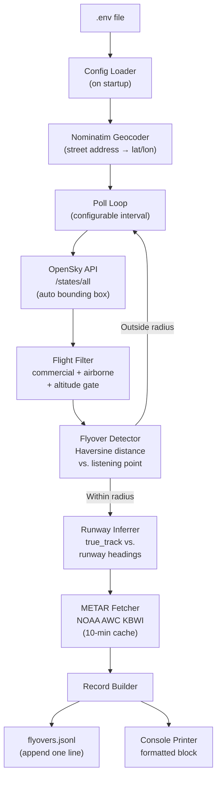

# BWI Flyover Tracker — App Specification (FINAL)

A barebones **Python** CLI app that polls live ADS-B flight data for commercial departures from BWI,
detects flyovers above a configurable home location in Elkridge MD, and on each detection:

1. **Appends** a JSON record to `flyovers.jsonl`
2. **Prints** a formatted human-readable block to the console

Run it in one terminal. Watch it live. Cross-reference with planes you hear overhead.

---

## Background & Goals

The user lives in Elkridge, MD — directly under one of BWI's primary departure corridors. The app
answers: *"Which runway did that plane use, and what was the wind doing when it took off?"*

All user-tunable settings live in a single `.env` file. On startup the app geocodes the configured
street address via Nominatim (OpenStreetMap, free, no key needed) and caches the coordinates for
the session.

### Geographic Reference Points

| Location | Coordinates |
|---|---|
| BWI Airport (KBWI) | 39.1754° N, 76.6682° W |
| Elkridge, MD (approx. center) | 39.21° N, 76.71° W |
| Elkridge relative to BWI | ~3 mi northwest |

### BWI Runways

| Runway | Magnetic Heading | Common Use |
|---|---|---|
| **10** | ~105° (eastbound) | Arrivals & departures |
| **28** | ~285° (westbound) | Primary departure (noise abatement) |
| **15R** | ~155° (southeast) | Departures & arrivals |
| **33L** | ~335° (northwest) | Departures & arrivals |

> [!NOTE]
> Runway 28 departures heading west are the most common flyover source for Elkridge.
> Runway 33L (northwest) is also a likely culprit.

---

## Data Sources

### 1. Flight Positions — OpenSky Network REST API (Free)
- **Endpoint:** `GET https://opensky-network.org/api/states/all?lamin=...&lomin=...&lamax=...&lomax=...`
- **Auth:** OAuth2 client credentials — free account at opensky-network.org
- **Gives:** Real-time ADS-B state vectors: callsign, lat/lon, altitude, ground speed, true track, on-ground flag
- **Poll interval:** Configurable via `.env` (default 30 s)
- **Bounding box:** Auto-derived from geocoded address ± padding

### 2. Geocoding — Nominatim / OpenStreetMap (Free, no key)
- **Endpoint:** `GET https://nominatim.openstreetmap.org/search?q=<address>&format=json`
- **Gives:** lat/lon for the configured street address
- **Called:** Once on startup, cached in memory

### 3. Weather — NOAA Aviation Weather Center (Free, no key)
- **Endpoint:** `GET https://aviationweather.gov/api/data/metar?ids=KBWI&format=json`
- **Gives:** Wind direction + speed from the most recent KBWI METAR
- **Cached:** 10-minute TTL to avoid redundant requests

---

## Architecture



---

## `.env` Configuration

```ini
# --- OpenSky credentials (free account at opensky-network.org) ---
OPENSKY_CLIENT_ID=your_client_id_here
OPENSKY_CLIENT_SECRET=your_client_secret_here

# --- Listening location ---
# Full street address — geocoded automatically via OpenStreetMap on startup
LISTEN_ADDRESS=123 Main St, Elkridge, MD 21075

# --- Detection radius ---
# How close a plane must pass to count as a flyover (nautical miles)
# 1 nm ≈ 1.15 miles. Start with 1.0 and tune down if too noisy.
FLYOVER_RADIUS_NM=1.0

# --- OpenSky search area ---
# Extra distance beyond the flyover radius included in the queried bounding box.
BBOX_PADDING_NM=20.0

# --- Polling ---
# How often to query OpenSky (seconds). Minimum recommended: 30
POLL_INTERVAL_SEC=30
```

`.env.example` is checked into source control with empty credential fields.

---

## Core Modules

### `config.py` — Settings Loader

Reads `.env`, geocodes the address, derives the bounding box, exposes a `Settings` dataclass.

```python
@dataclass
class Settings:
    opensky_client_id: str
    opensky_client_secret: str
    listen_address: str
    listen_lat: float
    listen_lon: float
    flyover_radius_nm: float
    bbox: dict          # {lamin, lomin, lamax, lomax}
    poll_interval_sec: int
    runways: dict[str, int]  # {"28": 285, "10": 105, "15R": 155, "33L": 335}
```

---

### `geocoder.py` — Address → Coordinates

```python
def geocode_address(address: str) -> tuple[float, float]:
    """
    Calls Nominatim → returns (lat, lon).
    User-Agent: 'bwi-flyover-tracker/1.0' (required by OSM policy).
    Raises ValueError with a clear message if address cannot be resolved.
    """
```

---

### `opensky_client.py` — Flight Data Fetcher

Manages the OAuth2 token (auto-refresh on expiry) and polls `/states/all`.

```python
@dataclass
class StateVector:
    icao24: str       # hex transponder ID
    callsign: str     # e.g. "SWA1234"
    longitude: float
    latitude: float
    altitude_m: float
    velocity_mps: float
    true_track: float  # 0–360°, clockwise from north
    on_ground: bool
    timestamp: int     # unix epoch
```

---

### `flyover_detector.py` — Spatial Filter

```python
def is_flyover(sv: StateVector, settings: Settings) -> bool:
    """
    Returns True if all conditions met:
      - on_ground == False
      - 500 ft ≤ altitude ≤ 10,000 ft  (departure gate)
      - callsign starts with 3 alpha chars  (commercial heuristic)
      - Haversine distance to listen point ≤ flyover_radius_nm
    """
```

---

### `runway_inferrer.py` — Runway Detection

```python
def infer_runway(true_track: float, runways: dict[str, int]) -> tuple[str, str]:
    """
    Returns (runway_id, label) e.g. ("28", "28 (West)").
    Tolerance ±20°. Closest angular match wins.
    Falls back to ("UNKNOWN", "Unknown direction").
    """
```

Cardinal direction labels derived from heading:
`N, NNE, NE, ENE, E, ESE, SE, SSE, S, SSW, SW, WSW, W, WNW, NW, NNW`

> [!NOTE]
> `true_track` at the time of flyover is used as a proxy for the departure runway heading.
> This is best-effort — accuracy is highest for low-altitude departures shortly after takeoff.

---

### `weather_client.py` — METAR Fetcher

```python
@dataclass
class WindObs:
    direction_deg: int   # degrees FROM, 0 = variable/calm
    speed_kt: int
    gust_kt: int | None
    raw_metar: str
    observed_at: datetime

def get_wind_kbwi() -> WindObs:
    """Fetches latest KBWI METAR. Returns cached result within 10-min TTL."""
```

---

### `record_builder.py` — Output Schema

```python
@dataclass
class FlyoverRecord:
    timestamp: str         # ISO 8601 local time
    flight_number: str     # callsign, e.g. "SWA1234"
    icao24: str
    altitude_ft: int
    true_track_deg: float
    runway: str            # "28", "33L", or "UNKNOWN"
    runway_direction: str  # "28 (West)", "33L (NNW)", etc.
    wind_direction_deg: int
    wind_speed_kt: int
    wind_gust_kt: int | None
    raw_metar: str

def to_json_line(record: FlyoverRecord) -> str:
    """Serializes to a single JSON line for appending to flyovers.jsonl."""
```

**Example `flyovers.jsonl` line:**
```json
{"timestamp": "2026-10-05T07:12:33-04:00", "flight_number": "SWA1234", "icao24": "a1b2c3", "altitude_ft": 3200, "true_track_deg": 281.4, "runway": "28", "runway_direction": "28 (West)", "wind_direction_deg": 270, "wind_speed_kt": 12, "wind_gust_kt": 18, "raw_metar": "KBWI 051254Z 27012G18KT 10SM FEW040 22/10 A2992"}
```

---

### `printer.py` — Console Output

Prints a formatted block to stdout for each flyover **and** appends to `flyovers.jsonl`:

```
━━━━━━━━━━━━━━━━━━━━━━━━━━━━━━━━━━━━━━━━━━━━━
✈  SWA1234          2026-10-05 07:12:33 EDT
   Altitude  : 3,200 ft  |  Speed: 245 kt
   Heading   : 281°
   Runway    : 28 (West)
   Wind      : 270° at 12 kt, gusting 18 kt
   METAR     : KBWI 051254Z 27012G18KT 10SM FEW040 22/10 A2992
   Logged to : flyovers.jsonl
━━━━━━━━━━━━━━━━━━━━━━━━━━━━━━━━━━━━━━━━━━━━━
```

---

### `main.py` — Entry Point & Poll Loop

**Startup banner:**
```
BWI Flyover Tracker
━━━━━━━━━━━━━━━━━━━━━━━━━━━━━━━━━━━━━━━━━━━━━
Listening at : 123 Main St, Elkridge, MD 21075
Coordinates  : 39.21000°N, 76.71000°W
Radius       : 1.0 nm (~1.15 miles)
Poll interval: 30s
Log file     : flyovers.jsonl
Runways      : 10 (105°), 28 (285°), 15R (155°), 33L (335°)
━━━━━━━━━━━━━━━━━━━━━━━━━━━━━━━━━━━━━━━━━━━━━
Waiting for flyovers...
```

**Poll loop:**
```python
seen: dict[str, float] = {}   # {icao24: last_seen_epoch}

while True:
    vectors = client.fetch()
    now = time.time()
    for sv in vectors:
        if flyover_detector.is_flyover(sv, settings):
            # deduplicate — same plane can't trigger twice within 10 min
            if now - seen.get(sv.icao24, 0) > 600:
                runway, label = runway_inferrer.infer_runway(sv.true_track, settings.runways)
                wind = weather_client.get_wind_kbwi()
                record = record_builder.build(sv, runway, label, wind)
                printer.print_and_log(record)   # console + file
                seen[sv.icao24] = now
    time.sleep(settings.poll_interval_sec)
```

---

## File Layout

```
flights/
├── .env                  # credentials & settings (gitignored)
├── .env.example          # template (checked in)
├── .gitignore
├── config.py
├── geocoder.py
├── opensky_client.py
├── flyover_detector.py
├── runway_inferrer.py
├── weather_client.py
├── record_builder.py
├── printer.py
├── main.py
├── flyovers.jsonl        # auto-created on first flyover (gitignored)
├── requirements.txt
└── README.md
```

---

## Dependencies

```
requests>=2.31
python-dotenv>=1.0
```

Standard library only beyond that: `math`, `dataclasses`, `datetime`, `json`, `time`, `re`, `os`.

---

## Open Questions

> [!IMPORTANT]
> You'll need a free OpenSky account to get `OPENSKY_CLIENT_ID` / `OPENSKY_CLIENT_SECRET`.
> Sign up at [opensky-network.org](https://opensky-network.org/) — no credit card required.

> [!NOTE]
> The commercial callsign filter (3-letter alpha prefix = airline code) can be relaxed to include
> all non-ground traffic if you want to see cargo or charter flights too.

---

## Verification Plan

### Automated Tests
```bash
python -m pytest tests/ -v
# Covers: Haversine math, runway heading inference,
#         METAR parsing, address geocoding, JSON serialization
```

### Manual Verification
1. Run `python main.py` — confirm startup banner shows correct geocoded coordinates.
2. Open [FlightAware BWI Live Map](https://flightaware.com/live/airport/KBWI) in a browser.
3. When a flight passes over your location on FlightAware, confirm the app prints a matching entry within ~30–60 s.
4. Cross-check runway against [BWI WebTrak](https://bwiairport.com/to-from-bwi/airport-information/community/noise-program).
5. Verify `flyovers.jsonl` is being appended with valid JSON lines.
